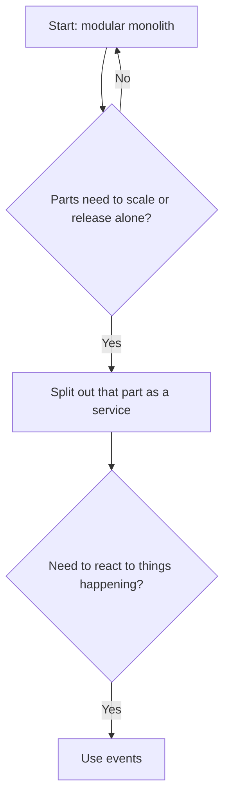
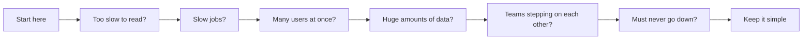

# Common Architecture Patterns

## The big idea in plain words {#picture}

There are many ways to organize a big app, like many ways to organize a school. One building with clear wings. Many small buildings that talk by phone. A system that passes notes between rooms. None is best for all schools. The skill is choosing the simplest one that fits.

Each pattern is a tool with a price. In this lesson you will learn the price tag of each one.



## What you will be able to do {#outcomes}

By the end of this lesson you will be able to:

- Compare monolith, microservices, events, CQRS, outbox, saga, and serverless.
- Explain the strangler pattern for moving old systems step by step.
- Choose a pattern and say what it costs.

## Words to know {#vocabulary}

- **modular monolith**: one app with tidy, separate parts inside.
- **microservices**: many small apps that talk over the network.
- **event-driven**: parts react to messages that say "this happened".
- **saga**: steps with "undo" steps for each, used across services.
- **strangler pattern**: slowly replacing an old system piece by piece.
- **serverless**: you give code to a provider that runs it only when needed.

## Why this idea exists {#history}

Teams copy what big companies do and end up with a system too complicated for them. Knowing the costs helps you pick only what you need.

## Concept 1: Start with a modular monolith {#concept-1}

One program, with folders that match the parts: users, notes, billing. It is easy to run, test, and change. Most apps never need to leave this stage.

## Concept 2: Microservices cost a lot {#concept-2}

Each service needs its own deployment, monitoring, and database. Calls between them can fail or be slow. They help when separate teams or very different loads need independence. Without that need, they add work.

## Concept 3: Events and sagas {#concept-3}

With events, one part says "order placed" and others react: send email, update stock. The sender does not need to know who listens. For long processes across services, a saga runs the steps and has an undo step for each.

## Concept 4: Replace old systems slowly {#concept-4}

You do not rebuild an old system overnight. With the strangler pattern, you put a front in front of it and move one feature at a time to the new system. Over time, the old one has nothing left to do and can be turned off.

## A shop grows up {#example}

Year one: one app and one database. Year two: emails and image resizing move to workers with a queue. Year three: search becomes its own service because it needs different hardware. The shop never did a big rewrite. It split pieces out only when a real need appeared.

## Going deeper: the technical walkthrough {#walkthrough}

### Architecture patterns


| Problem | Starting design | Add when evidence requires it |
| --- | --- | --- |
| small CRUD product | layered modular monolith | indexes, audit, measured cache |
| repeated reads | indexed API | cache-aside and invalidation |
| long export | job record and worker | queue, retries, dead letters |
| many reactions to a write | transaction plus outbox | event consumers |
| legacy migration | strangler adapter | route-by-route replacement |
| payment workflow | state machine and idempotency | saga or provider boundary |
| large text search | database search | dedicated search index |
| multiple teams | modular monolith | service split by ownership |

Microservices are a deployment and ownership choice, not a synonym for quality.
Start with a modular monolith when the product is small and the boundaries are
still changing.


## Worked scenario {#worked-scenario}

A small team builds a simple CRUD app and has no separate scaling problem. What should it start with?

The justified choice is **A modular monolith with clear ports**. Select **modular-monolith** in the structured practical and explain why. Alternatives ignore a requirement, cross a trust boundary, or invent success.

### Structured decision contract

```json

{
  "decision": "modular-monolith",
  "justification": "The monolith and port boundary must preserve the declared contract and ownership.",
  "failureBehavior": "Expose a safe failure and recover through the boundary owner."
}

```

Decision selects one declared behavior. Justification explains the boundary. FailureBehavior explains the observable error and recovery owner. These fields never execute commands. Required terms and minimum lengths form a basic practice rubric, not semantic grading.

## Step-by-step flow and matching picture {#flow}




## Three real-life uses {#use-cases}

1. A startup keeps one codebase while the team is small.
2. A big retailer uses events so inventory, shipping, and billing stay in sync.
3. A company slowly replaces an old billing system using the strangler pattern.

## What can go wrong, and how to stay safe {#failure-security}

Mistakes: microservices on day one, services that share one database (so they are not really separate), and events with no owner so nobody knows who reacts to what. Draw the arrows. If you cannot draw them, the design is too tangled.

## Practice lab and expected observation {#practice}

1. Predict the scenario decision before opening Practical. Explain each rejected alternative.
2. Run a relevant example above in an isolated exercise project. Record the expected result, then change one input to an invalid or boundary value. A failed assertion or deliberate error should replace silent success.
3. Submit the structured decision. Initially the checks fail. After selecting modular-monolith and writing an explanation and failure plan, all three pass. Follow the indicated review section for missed checks.

### Broken example to debug

```json

{"decision":"trust-client","justification":"","failureBehavior":""}

```

This ignores the responsible boundary and gives no reasoning or recovery. Correct the fields rather than changing the validator.

## Checkpoint and definition of done {#checkpoint}

- [ ] Define monolith and port without looking.
- [ ] Trace input to owner and output.
- [ ] Explain one failure and one alternative.
- [ ] Pass at least four assignment questions.
- [ ] Pass every practical check and submit.
- [ ] Explain the concept again tomorrow.

## Sources, versions, and safe commands {#sources}

Workload figures are assumptions until measured. Review date: 2026-10-02. The supplied blueprint is the teaching source; official landing pages were checked where reachable. No provider or original TM Schedule deployment was tested.

- [Official reference](https://www.postgresql.org/docs/current/)

- [Official reference](https://opentelemetry.io/docs/)

[Course reading order](README.md) · [Previous lesson](14-deployment-cloud-and-disaster-recovery.md) · [Next lesson](16-design-interview-and-review-method.md)

```study-quiz

{
  "schemaVersion": 1,
  "lessonId": "system-design/15-common-architecture-patterns",
  "title": "Assignment: Common Architecture Patterns",
  "passPercentage": 80,
  "questions": [
    {
      "id": "q1",
      "sectionId": "concept-1",
      "prompt": "In Common Architecture Patterns, what does monolith mean?",
      "options": [
        {
          "id": "a",
          "text": "an app that is built and shipped as one piece",
          "explanation": "This preserves the definition and boundary described in the lesson."
        },
        {
          "id": "b",
          "text": "A permission granted by a hidden browser control",
          "explanation": "This changes the declared meaning or bypasses the responsible boundary."
        },
        {
          "id": "c",
          "text": "An unlimited provider operation with no ownership",
          "explanation": "This changes the declared meaning or bypasses the responsible boundary."
        },
        {
          "id": "d",
          "text": "A diagnostic credential intended for public logs",
          "explanation": "This changes the declared meaning or bypasses the responsible boundary."
        }
      ],
      "correctOptionId": "a",
      "explanation": "monolith means an app that is built and shipped as one piece.",
      "reviewLabel": "Review concept 1"
    },
    {
      "id": "q2",
      "sectionId": "concept-2",
      "prompt": "In Common Architecture Patterns, which rule is correct for checkpoint 2?",
      "options": [
        {
          "id": "a",
          "text": "Trust client-side checks instead of the server rule.",
          "explanation": "This changes the declared meaning or bypasses the responsible boundary."
        },
        {
          "id": "b",
          "text": "Split into a service only when you truly need to scale or release it separately.",
          "explanation": "This preserves the definition and boundary described in the lesson."
        },
        {
          "id": "c",
          "text": "Hide the failure by returning a fabricated successful result.",
          "explanation": "This changes the declared meaning or bypasses the responsible boundary."
        },
        {
          "id": "d",
          "text": "Skip the stated boundary, limit, or ownership check.",
          "explanation": "This changes the declared meaning or bypasses the responsible boundary."
        }
      ],
      "correctOptionId": "b",
      "explanation": "Split into a service only when you truly need to scale or release it separately.",
      "reviewLabel": "Review concept 2"
    },
    {
      "id": "q3",
      "sectionId": "concept-3",
      "prompt": "In Common Architecture Patterns, which rule is correct for checkpoint 3?",
      "options": [
        {
          "id": "a",
          "text": "Trust client-side checks instead of the server rule.",
          "explanation": "This changes the declared meaning or bypasses the responsible boundary."
        },
        {
          "id": "b",
          "text": "Hide the failure by returning a fabricated successful result.",
          "explanation": "This changes the declared meaning or bypasses the responsible boundary."
        },
        {
          "id": "c",
          "text": "An outbox keeps messages safe until they are sent.",
          "explanation": "This preserves the definition and boundary described in the lesson."
        },
        {
          "id": "d",
          "text": "Skip the stated boundary, limit, or ownership check.",
          "explanation": "This changes the declared meaning or bypasses the responsible boundary."
        }
      ],
      "correctOptionId": "c",
      "explanation": "An outbox keeps messages safe until they are sent.",
      "reviewLabel": "Review concept 3"
    },
    {
      "id": "q4",
      "sectionId": "concept-4",
      "prompt": "In Common Architecture Patterns, which rule is correct for checkpoint 4?",
      "options": [
        {
          "id": "a",
          "text": "Trust client-side checks instead of the server rule.",
          "explanation": "This changes the declared meaning or bypasses the responsible boundary."
        },
        {
          "id": "b",
          "text": "Hide the failure by returning a fabricated successful result.",
          "explanation": "This changes the declared meaning or bypasses the responsible boundary."
        },
        {
          "id": "c",
          "text": "Skip the stated boundary, limit, or ownership check.",
          "explanation": "This changes the declared meaning or bypasses the responsible boundary."
        },
        {
          "id": "d",
          "text": "CQRS splits reading and writing, and brings extra coordination.",
          "explanation": "This preserves the definition and boundary described in the lesson."
        }
      ],
      "correctOptionId": "d",
      "explanation": "CQRS splits reading and writing, and brings extra coordination.",
      "reviewLabel": "Review concept 4"
    },
    {
      "id": "q5",
      "sectionId": "worked-scenario",
      "prompt": "A small team builds a simple CRUD app and has no separate scaling problem. What should it start with?",
      "options": [
        {
          "id": "a",
          "text": "A modular monolith with clear ports",
          "explanation": "This preserves the definition and boundary described in the lesson."
        },
        {
          "id": "b",
          "text": "One service for every class",
          "explanation": "This changes the declared meaning or bypasses the responsible boundary."
        },
        {
          "id": "c",
          "text": "Distributed transactions for every read",
          "explanation": "This changes the declared meaning or bypasses the responsible boundary."
        },
        {
          "id": "d",
          "text": "A database that every browser can reach directly",
          "explanation": "This changes the declared meaning or bypasses the responsible boundary."
        }
      ],
      "correctOptionId": "a",
      "explanation": "A modular monolith with clear ports. A saga fixes mistakes with undo steps, not one magic rollback.",
      "reviewLabel": "Review the worked scenario"
    }
  ]
}

```

```study-practical

{
  "schemaVersion": 1,
  "challengeId": "system-design/15-common-architecture-patterns/decision",
  "lessonId": "system-design/15-common-architecture-patterns",
  "title": "Practical: Common Architecture Patterns",
  "language": "json",
  "mode": "structured",
  "instructions": "A small team builds a simple CRUD app and has no separate scaling problem. What should it start with? Return an object with decision (choose from modular-monolith, skip-check, unbounded-work, trust-client), justification (at least 40 characters; include monolith and port), and failureBehavior (at least 25 characters; include failure and recover while explaining the error and recovery). These are structured reasoning checks, not code execution or an official grade.",
  "starterCode": "{\n  \"decision\": \"\",\n  \"justification\": \"\",\n  \"failureBehavior\": \"\"\n}",
  "entryPoint": "answer",
  "publicExamples": [
    {
      "input": {
        "decision": "skip-check",
        "justification": "",
        "failureBehavior": ""
      },
      "expected": {
        "passed": false
      }
    },
    {
      "input": {
        "decision": "modular-monolith",
        "justification": "The monolith and port boundary must preserve the declared contract and ownership.",
        "failureBehavior": "Show a safe failure and recover through the responsible owner."
      },
      "expected": {
        "passed": true
      }
    }
  ],
  "publicTestIds": [
    "decision",
    "explanation",
    "failure-plan"
  ],
  "reviewSections": {
    "decision": "worked-scenario",
    "explanation": "concept-2",
    "failure-plan": "failure-security"
  },
  "limits": {
    "timeMs": 2000,
    "memoryMb": 128,
    "outputBytes": 20000
  }
}

```

