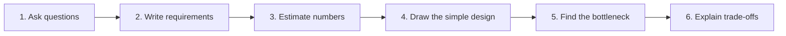
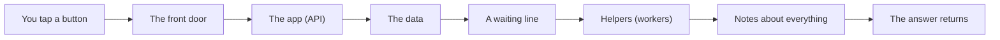

# Design Interview And Review Method

## The big idea in plain words {#picture}

A design interview is like explaining a science project to a judge. You do not just show the finished model. You explain the problem, show your numbers, describe the steps, point to the weak spots, and say why you did not choose other ideas.

The same steps work for real design reviews at work. They keep a conversation calm, clear, and kind.



## What you will be able to do {#outcomes}

By the end of this lesson you will be able to:

- Follow a six-step method to present any design.
- Think aloud and explain trade-offs.
- Review a design politely and usefully.

## Words to know {#vocabulary}

- **bottleneck**: the narrowest part that limits how much can flow, like the neck of a bottle.
- **trade-off**: what you gain and what you give up.
- **assumption**: something we treat as true because we do not know for sure.
- **design review**: a meeting where people check a plan before building it.
- **alternative**: another choice you could have made.
- **non-goal**: something we decide not to do right now.

## Why this idea exists {#history}

Even a great design fails if nobody can follow it. A clear method means that your ideas get understood, your mistakes get caught early, and your team trusts the plan.

## Concept 1: Ask before drawing {#concept-1}

Spend the first few minutes on questions: Who are the users? What are the main actions? How many? What must never go wrong? It is okay to say "I will assume 10,000 users" if nobody tells you.

## Concept 2: Draw the simplest thing first {#concept-2}

Begin with the basic path: client, API, database. Then add one thing at a time and say why: "reads are slow, so I add a cache". The listener can follow every step.

## Concept 3: Name the weak spot {#concept-3}

Say where the design might break: "the database is the bottleneck when writes grow". Showing the weak spot is a sign of strength, not weakness. It tells people you understand the limits.

## Concept 4: Explain what you did not choose {#concept-4}

"I did not use microservices because we have one small team." One sentence on each rejected choice proves you considered options. Also write down non-goals: what we will not build yet.

## Five minutes for a link shortener {#example}

Ask: how many links per day? Say 1 million. Write: create a short link, open a link, fast opens. Estimate: 12 creates per second, 120 opens per second. Draw: client, API, database, cache. Weak spot: opens, so add a cache. Rejected: sharding, not needed at this size.

## Going deeper: the technical walkthrough {#walkthrough}

### Design review method


Present a design in this order:

1. users and requirements;
2. assumptions and capacity numbers;
3. high-level boxes and ownership;
4. read path;
5. write path;
6. data model and consistency;
7. bottleneck and scale plan;
8. failure handling;
9. security and privacy;
10. observability, deployment, backup, and trade-offs.

Explain one rejected alternative. A reviewer learns more from the reason for a
choice than from a list of fashionable components.


## Worked scenario {#worked-scenario}

Imagine 1200 active users each read once per minute. What is the average read load?

The justified choice is **About 20 requests per second before adding a busy-time factor**. Select **twenty-rps** in the structured practical and explain why. Alternatives ignore a requirement, cross a trust boundary, or invent success.

### Structured decision contract

```json

{
  "decision": "twenty-rps",
  "justification": "The functionalRequirement and qualityRequirement boundary must preserve the declared contract and ownership.",
  "failureBehavior": "Expose a safe failure and recover through the boundary owner."
}

```

Decision selects one declared behavior. Justification explains the boundary. FailureBehavior explains the observable error and recovery owner. These fields never execute commands. Required terms and minimum lengths form a basic practice rubric, not semantic grading.

## Step-by-step flow and matching picture {#flow}




## Three real-life uses {#use-cases}

1. A team reviews a drawing before spending months building.
2. An engineer explains a design to a new teammate with six clear steps.
3. A student practices by drawing a known app (like a photo app) from memory.

## What can go wrong, and how to stay safe {#failure-security}

Mistakes: jumping straight to fancy tools, hiding the weak spots, using words nobody explained, and saying "it depends" without finishing the sentence ("it depends on X, and in our case X is Y, so I choose Z").

## Practice lab and expected observation {#practice}

1. Predict the scenario decision before opening Practical. Explain each rejected alternative.
2. Run a relevant example above in an isolated exercise project. Record the expected result, then change one input to an invalid or boundary value. A failed assertion or deliberate error should replace silent success.
3. Submit the structured decision. Initially the checks fail. After selecting twenty-rps and writing an explanation and failure plan, all three pass. Follow the indicated review section for missed checks.

### Broken example to debug

```json

{"decision":"trust-client","justification":"","failureBehavior":""}

```

This ignores the responsible boundary and gives no reasoning or recovery. Correct the fields rather than changing the validator.

## Checkpoint and definition of done {#checkpoint}

- [ ] Define functionalRequirement and qualityRequirement without looking.
- [ ] Trace input to owner and output.
- [ ] Explain one failure and one alternative.
- [ ] Pass at least four assignment questions.
- [ ] Pass every practical check and submit.
- [ ] Explain the concept again tomorrow.

## Sources, versions, and safe commands {#sources}

Workload figures are assumptions until measured. Review date: 2026-10-02. The supplied blueprint is the teaching source; official landing pages were checked where reachable. No provider or original TM Schedule deployment was tested.

- [Official reference](https://www.postgresql.org/docs/current/)

- [Official reference](https://opentelemetry.io/docs/)

[Course reading order](README.md) · [Previous lesson](15-common-architecture-patterns.md) · [Next lesson](17-tm-schedule-end-to-end-case-study.md)

```study-quiz

{
  "schemaVersion": 1,
  "lessonId": "system-design/16-design-interview-and-review-method",
  "title": "Assignment: Design Interview And Review Method",
  "passPercentage": 80,
  "questions": [
    {
      "id": "q1",
      "sectionId": "concept-1",
      "prompt": "In Design Interview And Review Method, what does functionalRequirement mean?",
      "options": [
        {
          "id": "a",
          "text": "A permission granted by a hidden browser control",
          "explanation": "This changes the declared meaning or bypasses the responsible boundary."
        },
        {
          "id": "b",
          "text": "something the system must do",
          "explanation": "This preserves the definition and boundary described in the lesson."
        },
        {
          "id": "c",
          "text": "An unlimited provider operation with no ownership",
          "explanation": "This changes the declared meaning or bypasses the responsible boundary."
        },
        {
          "id": "d",
          "text": "A diagnostic credential intended for public logs",
          "explanation": "This changes the declared meaning or bypasses the responsible boundary."
        }
      ],
      "correctOptionId": "b",
      "explanation": "functionalRequirement means something the system must do.",
      "reviewLabel": "Review concept 1"
    },
    {
      "id": "q2",
      "sectionId": "concept-2",
      "prompt": "In Design Interview And Review Method, which rule is correct for checkpoint 2?",
      "options": [
        {
          "id": "a",
          "text": "Trust client-side checks instead of the server rule.",
          "explanation": "This changes the declared meaning or bypasses the responsible boundary."
        },
        {
          "id": "b",
          "text": "Hide the failure by returning a fabricated successful result.",
          "explanation": "This changes the declared meaning or bypasses the responsible boundary."
        },
        {
          "id": "c",
          "text": "Average load is not the same as the busiest moment.",
          "explanation": "This preserves the definition and boundary described in the lesson."
        },
        {
          "id": "d",
          "text": "Skip the stated boundary, limit, or ownership check.",
          "explanation": "This changes the declared meaning or bypasses the responsible boundary."
        }
      ],
      "correctOptionId": "c",
      "explanation": "Average load is not the same as the busiest moment.",
      "reviewLabel": "Review concept 2"
    },
    {
      "id": "q3",
      "sectionId": "concept-3",
      "prompt": "In Design Interview And Review Method, which rule is correct for checkpoint 3?",
      "options": [
        {
          "id": "a",
          "text": "Trust client-side checks instead of the server rule.",
          "explanation": "This changes the declared meaning or bypasses the responsible boundary."
        },
        {
          "id": "b",
          "text": "Hide the failure by returning a fabricated successful result.",
          "explanation": "This changes the declared meaning or bypasses the responsible boundary."
        },
        {
          "id": "c",
          "text": "Skip the stated boundary, limit, or ownership check.",
          "explanation": "This changes the declared meaning or bypasses the responsible boundary."
        },
        {
          "id": "d",
          "text": "Estimate storage as number of items times size times how long you keep them.",
          "explanation": "This preserves the definition and boundary described in the lesson."
        }
      ],
      "correctOptionId": "d",
      "explanation": "Estimate storage as number of items times size times how long you keep them.",
      "reviewLabel": "Review concept 3"
    },
    {
      "id": "q4",
      "sectionId": "concept-4",
      "prompt": "In Design Interview And Review Method, which rule is correct for checkpoint 4?",
      "options": [
        {
          "id": "a",
          "text": "Speed, uptime, and cost are different goals.",
          "explanation": "This preserves the definition and boundary described in the lesson."
        },
        {
          "id": "b",
          "text": "Trust client-side checks instead of the server rule.",
          "explanation": "This changes the declared meaning or bypasses the responsible boundary."
        },
        {
          "id": "c",
          "text": "Hide the failure by returning a fabricated successful result.",
          "explanation": "This changes the declared meaning or bypasses the responsible boundary."
        },
        {
          "id": "d",
          "text": "Skip the stated boundary, limit, or ownership check.",
          "explanation": "This changes the declared meaning or bypasses the responsible boundary."
        }
      ],
      "correctOptionId": "a",
      "explanation": "Speed, uptime, and cost are different goals.",
      "reviewLabel": "Review concept 4"
    },
    {
      "id": "q5",
      "sectionId": "worked-scenario",
      "prompt": "Imagine 1200 active users each read once per minute. What is the average read load?",
      "options": [
        {
          "id": "a",
          "text": "1200 requests per millisecond",
          "explanation": "This changes the declared meaning or bypasses the responsible boundary."
        },
        {
          "id": "b",
          "text": "About 20 requests per second before adding a busy-time factor",
          "explanation": "This preserves the definition and boundary described in the lesson."
        },
        {
          "id": "c",
          "text": "Zero because reading is free",
          "explanation": "This changes the declared meaning or bypasses the responsible boundary."
        },
        {
          "id": "d",
          "text": "A peak of 20 that nobody measured",
          "explanation": "This changes the declared meaning or bypasses the responsible boundary."
        }
      ],
      "correctOptionId": "b",
      "explanation": "About 20 requests per second before adding a busy-time factor. Start with the simplest design that fits the stated workload.",
      "reviewLabel": "Review the worked scenario"
    }
  ]
}

```

```study-practical

{
  "schemaVersion": 1,
  "challengeId": "system-design/16-design-interview-and-review-method/decision",
  "lessonId": "system-design/16-design-interview-and-review-method",
  "title": "Practical: Design Interview And Review Method",
  "language": "json",
  "mode": "structured",
  "instructions": "Imagine 1200 active users each read once per minute. What is the average read load? Return an object with decision (choose from twenty-rps, skip-check, unbounded-work, trust-client), justification (at least 40 characters; include functionalRequirement and qualityRequirement), and failureBehavior (at least 25 characters; include failure and recover while explaining the error and recovery). These are structured reasoning checks, not code execution or an official grade.",
  "starterCode": "{\n  \"decision\": \"\",\n  \"justification\": \"\",\n  \"failureBehavior\": \"\"\n}",
  "entryPoint": "answer",
  "publicExamples": [
    {
      "input": {
        "decision": "skip-check",
        "justification": "",
        "failureBehavior": ""
      },
      "expected": {
        "passed": false
      }
    },
    {
      "input": {
        "decision": "twenty-rps",
        "justification": "The functionalRequirement and qualityRequirement boundary must preserve the declared contract and ownership.",
        "failureBehavior": "Show a safe failure and recover through the responsible owner."
      },
      "expected": {
        "passed": true
      }
    }
  ],
  "publicTestIds": [
    "decision",
    "explanation",
    "failure-plan"
  ],
  "reviewSections": {
    "decision": "worked-scenario",
    "explanation": "concept-2",
    "failure-plan": "failure-security"
  },
  "limits": {
    "timeMs": 2000,
    "memoryMb": 128,
    "outputBytes": 20000
  }
}

```

