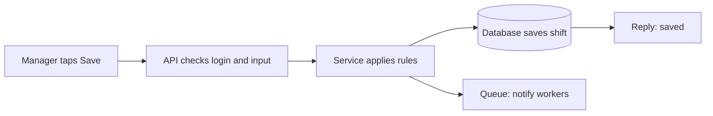
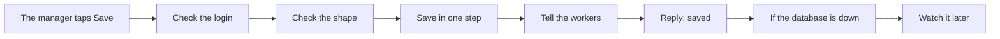
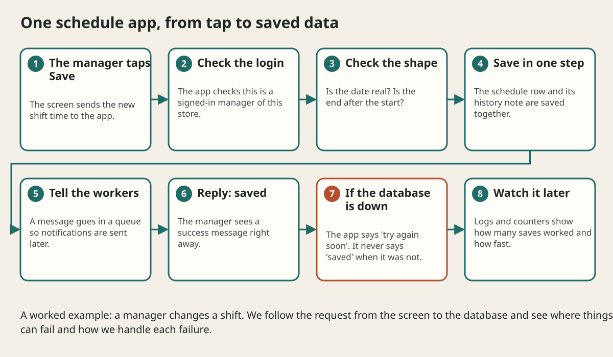

# Tm Schedule End To End Case Study

## The big idea in plain words {#picture}

**Case-study provenance:** the original TM Schedule source and endpoint contract were not supplied. These are illustrative schedule flows with synthetic data, not a verified inventory of that private application.

Now let us follow one real-style example from start to finish: a **schedule app** for a store. A manager opens it, sees who is working on which day, and changes a shift. We will trace what happens at every step, from the screen all the way to the database and back, and ask "what if this breaks?" at each stop.

Think of it as a field trip along the whole system. We have seen each stop in earlier lessons. Now we visit them in order.



## What you will be able to do {#outcomes}

By the end of this lesson you will be able to:

- Trace a full request through every layer.
- Spot where each failure could happen and how to answer it.
- Describe the tests, deployment, and monitoring for the same app.

## Words to know {#vocabulary}

- **shift**: one worker's time on the schedule.
- **end to end**: from the first tap to the final saved data.
- **layer**: one level of the app with one job.
- **happy path**: the way things go when nothing breaks.
- **failure path**: what happens when something does break.
- **synthetic data**: made-up data used for practice, not real people's data.

## Why this idea exists {#history}

Concepts become real when you see them work together. A full trip shows how a choice in one place (like a timeout) affects another place (like the screen).

## Concept 1: The happy path {#concept-1}

The manager changes Tuesday's shift and taps Save. The screen sends the request. The API checks the login, checks that the dates make sense, and calls the service. The service saves the shift in the database and replies "saved". The screen shows a green message.

## Concept 2: The failure paths {#concept-2}

What if the date is wrong? The API replies 422 with a friendly message. What if the manager is not allowed to edit this store? 403. What if the database is down? The API replies "try again soon" and does not claim it saved.

## Concept 3: Test each layer {#concept-3}

Unit tests check the rules ("end must be after start"). API tests check the replies. A test with a real database checks that the shift is saved correctly. Tests that make failures happen on purpose check the unhappy paths too.

## Concept 4: Deploy and watch {#concept-4}

The app is built into one package, tested, and rolled out slowly. A request ID follows every save through the logs. A dashboard shows saves per minute and errors. If the error count jumps, an alert tells a person.

## A save that times out {#example}

The manager taps Save and the reply never arrives. The screen shows "not sure it saved, please check". The manager taps Save again with the same request key. The server sees the key was already used and replies with the saved shift. No duplicate, no confusion.

## Going deeper: the technical walkthrough {#walkthrough}

### End-to-end case study


For a Study Library:

```text
browser -> HTTPS edge -> API
API -> PostgreSQL metadata
API -> private object storage for PDFs and images
API -> queue for ebook extraction or indexing
worker -> object storage and catalog metadata
signals -> logs, metrics, traces, alerts
```

The API must not return an empty library when the database or storage provider is
unavailable. It should return a retryable error and preserve the last known
catalog only when its freshness is visible. Document routes and media routes
should remain separate, and hosted media requires lawful rights and signed
access.


## Worked scenario {#worked-scenario}

A small team builds a simple CRUD app and has no separate scaling problem. What should it start with?

The justified choice is **A modular monolith with clear ports**. Select **modular-monolith** in the structured practical and explain why. Alternatives ignore a requirement, cross a trust boundary, or invent success.

### Structured decision contract

```json

{
  "decision": "modular-monolith",
  "justification": "The monolith and port boundary must preserve the declared contract and ownership.",
  "failureBehavior": "Expose a safe failure and recover through the boundary owner."
}

```

Decision selects one declared behavior. Justification explains the boundary. FailureBehavior explains the observable error and recovery owner. These fields never execute commands. Required terms and minimum lengths form a basic practice rubric, not semantic grading.

## Step-by-step flow and matching picture {#flow}





## Three real-life uses {#use-cases}

1. A restaurant manager changes shifts from a phone.
2. A worker checks next week's hours and gets a cached answer.
3. A nightly job emails each worker their schedule through a queue.

## What can go wrong, and how to stay safe {#failure-security}

Mistakes: showing "saved" before it really is, forgetting the "not allowed" check on the record, and a screen that gives no hint when a save may have failed. Note: the original schedule application was not supplied, so this lesson uses illustrative flows and made-up data, not a real private system.

## Practice lab and expected observation {#practice}

1. Predict the scenario decision before opening Practical. Explain each rejected alternative.
2. Run a relevant example above in an isolated exercise project. Record the expected result, then change one input to an invalid or boundary value. A failed assertion or deliberate error should replace silent success.
3. Submit the structured decision. Initially the checks fail. After selecting modular-monolith and writing an explanation and failure plan, all three pass. Follow the indicated review section for missed checks.

### Broken example to debug

```json

{"decision":"trust-client","justification":"","failureBehavior":""}

```

This ignores the responsible boundary and gives no reasoning or recovery. Correct the fields rather than changing the validator.

## Checkpoint and definition of done {#checkpoint}

- [ ] Define monolith and port without looking.
- [ ] Trace input to owner and output.
- [ ] Explain one failure and one alternative.
- [ ] Pass at least four assignment questions.
- [ ] Pass every practical check and submit.
- [ ] Explain the concept again tomorrow.

## Sources, versions, and safe commands {#sources}

Workload figures are assumptions until measured. Review date: 2026-10-02. The supplied blueprint is the teaching source; official landing pages were checked where reachable. No provider or original TM Schedule deployment was tested.

- [Official reference](https://www.postgresql.org/docs/current/)

- [Official reference](https://opentelemetry.io/docs/)

[Course reading order](README.md) · [Previous lesson](16-design-interview-and-review-method.md) · [Next lesson](18-application-architecture-cookbook-and-decision-guide.md)

```study-quiz

{
  "schemaVersion": 1,
  "lessonId": "system-design/17-tm-schedule-end-to-end-case-study",
  "title": "Assignment: Tm Schedule End To End Case Study",
  "passPercentage": 80,
  "questions": [
    {
      "id": "q1",
      "sectionId": "concept-1",
      "prompt": "In Tm Schedule End To End Case Study, what does monolith mean?",
      "options": [
        {
          "id": "a",
          "text": "A permission granted by a hidden browser control",
          "explanation": "This changes the declared meaning or bypasses the responsible boundary."
        },
        {
          "id": "b",
          "text": "An unlimited provider operation with no ownership",
          "explanation": "This changes the declared meaning or bypasses the responsible boundary."
        },
        {
          "id": "c",
          "text": "an app that is built and shipped as one piece",
          "explanation": "This preserves the definition and boundary described in the lesson."
        },
        {
          "id": "d",
          "text": "A diagnostic credential intended for public logs",
          "explanation": "This changes the declared meaning or bypasses the responsible boundary."
        }
      ],
      "correctOptionId": "c",
      "explanation": "monolith means an app that is built and shipped as one piece.",
      "reviewLabel": "Review concept 1"
    },
    {
      "id": "q2",
      "sectionId": "concept-2",
      "prompt": "In Tm Schedule End To End Case Study, which rule is correct for checkpoint 2?",
      "options": [
        {
          "id": "a",
          "text": "Trust client-side checks instead of the server rule.",
          "explanation": "This changes the declared meaning or bypasses the responsible boundary."
        },
        {
          "id": "b",
          "text": "Hide the failure by returning a fabricated successful result.",
          "explanation": "This changes the declared meaning or bypasses the responsible boundary."
        },
        {
          "id": "c",
          "text": "Skip the stated boundary, limit, or ownership check.",
          "explanation": "This changes the declared meaning or bypasses the responsible boundary."
        },
        {
          "id": "d",
          "text": "Split into a service only when you truly need to scale or release it separately.",
          "explanation": "This preserves the definition and boundary described in the lesson."
        }
      ],
      "correctOptionId": "d",
      "explanation": "Split into a service only when you truly need to scale or release it separately.",
      "reviewLabel": "Review concept 2"
    },
    {
      "id": "q3",
      "sectionId": "concept-3",
      "prompt": "In Tm Schedule End To End Case Study, which rule is correct for checkpoint 3?",
      "options": [
        {
          "id": "a",
          "text": "An outbox keeps messages safe until they are sent.",
          "explanation": "This preserves the definition and boundary described in the lesson."
        },
        {
          "id": "b",
          "text": "Trust client-side checks instead of the server rule.",
          "explanation": "This changes the declared meaning or bypasses the responsible boundary."
        },
        {
          "id": "c",
          "text": "Hide the failure by returning a fabricated successful result.",
          "explanation": "This changes the declared meaning or bypasses the responsible boundary."
        },
        {
          "id": "d",
          "text": "Skip the stated boundary, limit, or ownership check.",
          "explanation": "This changes the declared meaning or bypasses the responsible boundary."
        }
      ],
      "correctOptionId": "a",
      "explanation": "An outbox keeps messages safe until they are sent.",
      "reviewLabel": "Review concept 3"
    },
    {
      "id": "q4",
      "sectionId": "concept-4",
      "prompt": "In Tm Schedule End To End Case Study, which rule is correct for checkpoint 4?",
      "options": [
        {
          "id": "a",
          "text": "Trust client-side checks instead of the server rule.",
          "explanation": "This changes the declared meaning or bypasses the responsible boundary."
        },
        {
          "id": "b",
          "text": "CQRS splits reading and writing, and brings extra coordination.",
          "explanation": "This preserves the definition and boundary described in the lesson."
        },
        {
          "id": "c",
          "text": "Hide the failure by returning a fabricated successful result.",
          "explanation": "This changes the declared meaning or bypasses the responsible boundary."
        },
        {
          "id": "d",
          "text": "Skip the stated boundary, limit, or ownership check.",
          "explanation": "This changes the declared meaning or bypasses the responsible boundary."
        }
      ],
      "correctOptionId": "b",
      "explanation": "CQRS splits reading and writing, and brings extra coordination.",
      "reviewLabel": "Review concept 4"
    },
    {
      "id": "q5",
      "sectionId": "worked-scenario",
      "prompt": "A small team builds a simple CRUD app and has no separate scaling problem. What should it start with?",
      "options": [
        {
          "id": "a",
          "text": "One service for every class",
          "explanation": "This changes the declared meaning or bypasses the responsible boundary."
        },
        {
          "id": "b",
          "text": "Distributed transactions for every read",
          "explanation": "This changes the declared meaning or bypasses the responsible boundary."
        },
        {
          "id": "c",
          "text": "A modular monolith with clear ports",
          "explanation": "This preserves the definition and boundary described in the lesson."
        },
        {
          "id": "d",
          "text": "A database that every browser can reach directly",
          "explanation": "This changes the declared meaning or bypasses the responsible boundary."
        }
      ],
      "correctOptionId": "c",
      "explanation": "A modular monolith with clear ports. A saga fixes mistakes with undo steps, not one magic rollback.",
      "reviewLabel": "Review the worked scenario"
    }
  ]
}

```

```study-practical

{
  "schemaVersion": 1,
  "challengeId": "system-design/17-tm-schedule-end-to-end-case-study/decision",
  "lessonId": "system-design/17-tm-schedule-end-to-end-case-study",
  "title": "Practical: Tm Schedule End To End Case Study",
  "language": "json",
  "mode": "structured",
  "instructions": "A small team builds a simple CRUD app and has no separate scaling problem. What should it start with? Return an object with decision (choose from modular-monolith, skip-check, unbounded-work, trust-client), justification (at least 40 characters; include monolith and port), and failureBehavior (at least 25 characters; include failure and recover while explaining the error and recovery). These are structured reasoning checks, not code execution or an official grade.",
  "starterCode": "{\n  \"decision\": \"\",\n  \"justification\": \"\",\n  \"failureBehavior\": \"\"\n}",
  "entryPoint": "answer",
  "publicExamples": [
    {
      "input": {
        "decision": "skip-check",
        "justification": "",
        "failureBehavior": ""
      },
      "expected": {
        "passed": false
      }
    },
    {
      "input": {
        "decision": "modular-monolith",
        "justification": "The monolith and port boundary must preserve the declared contract and ownership.",
        "failureBehavior": "Show a safe failure and recover through the responsible owner."
      },
      "expected": {
        "passed": true
      }
    }
  ],
  "publicTestIds": [
    "decision",
    "explanation",
    "failure-plan"
  ],
  "reviewSections": {
    "decision": "worked-scenario",
    "explanation": "concept-2",
    "failure-plan": "failure-security"
  },
  "limits": {
    "timeMs": 2000,
    "memoryMb": 128,
    "outputBytes": 20000
  }
}

```

