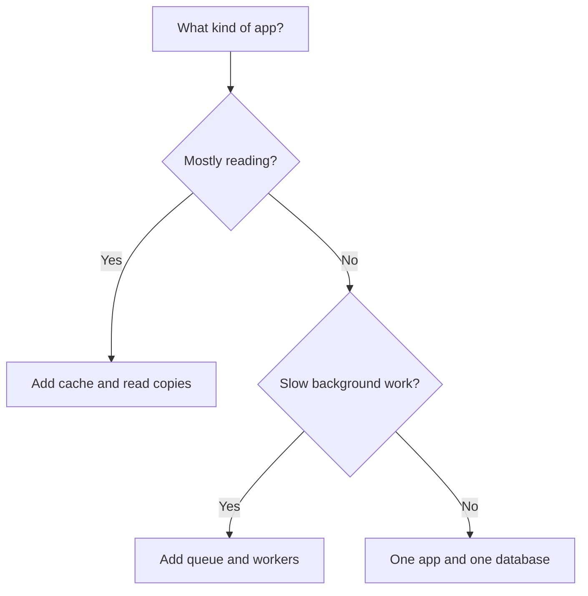
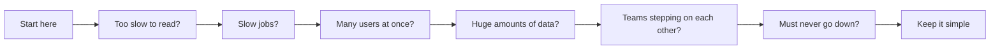
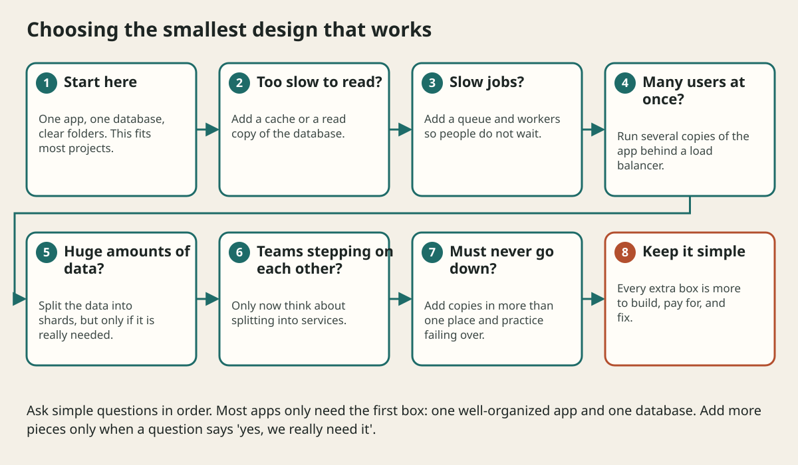

# Application Architecture Cookbook And Decision Guide

## The big idea in plain words {#picture}

Cooks use recipes. A recipe tells you the ingredients and the steps for a particular dish. Architects have recipes too. A chat app, a photo app, a payment app, and an online store each have a typical shape.

This lesson is a recipe book. For each kind of app we ask the same questions you learned: who, how much, what can break, and what is the simplest plan? Then we write the recipe.



## What you will be able to do {#outcomes}

By the end of this lesson you will be able to:

- Use the same method on many app types.
- Match a problem (reads, uploads, messages, payments) to a pattern.
- Say what to keep simple for each type.

## Words to know {#vocabulary}

- **CRUD**: Create, Read, Update, Delete, the four basic things apps do with data.
- **catalog**: a list of items people can browse, like products.
- **upload**: sending a file from a user to the server.
- **notification**: a message sent to tell someone something.
- **offline-first**: an app that works without internet and syncs later.
- **multi-tenant**: one app serving many separate customers at the same time.

## Why this idea exists {#history}

Most new apps look like one you have seen before. Reusing a known shape saves time and avoids old mistakes.

## Concept 1: Simple CRUD app {#concept-1}

Use an API and a database. Add checks, constraints, and good errors. That is it. Do not add pieces just because you can.

## Concept 2: Apps with lots of browsing {#concept-2}

Catalogs, news, and videos are read far more than written. Add a cache and a CDN (copies of files near users) and use read replicas for the database.

## Concept 3: Apps with files and slow work {#concept-3}

Uploads go straight to object storage. A queue and workers resize, scan, or convert them. The user sees "processing" and then "done". Notifications and emails also use a queue.

## Concept 4: Apps with money or many customers {#concept-4}

Payments need unique request keys so a retry never charges twice, and a record of every step. SaaS apps (software sold to many companies) must keep each customer's data separate and fair: one noisy customer must not slow the others.

## Chat in one paragraph {#example}

Messages arrive at the API and are saved. Online users are connected by a live connection so new messages appear immediately. If someone is offline, the message waits in the database and a push notification goes through a queue. Messages are sorted by time within each conversation.

## Going deeper: the technical walkthrough {#walkthrough}

### Architecture patterns


| Problem | Starting design | Add when evidence requires it |
| --- | --- | --- |
| small CRUD product | layered modular monolith | indexes, audit, measured cache |
| repeated reads | indexed API | cache-aside and invalidation |
| long export | job record and worker | queue, retries, dead letters |
| many reactions to a write | transaction plus outbox | event consumers |
| legacy migration | strangler adapter | route-by-route replacement |
| payment workflow | state machine and idempotency | saga or provider boundary |
| large text search | database search | dedicated search index |
| multiple teams | modular monolith | service split by ownership |

Microservices are a deployment and ownership choice, not a synonym for quality.
Start with a modular monolith when the product is small and the boundaries are
still changing.


### Design review method


Present a design in this order:

1. users and requirements;
2. assumptions and capacity numbers;
3. high-level boxes and ownership;
4. read path;
5. write path;
6. data model and consistency;
7. bottleneck and scale plan;
8. failure handling;
9. security and privacy;
10. observability, deployment, backup, and trade-offs.

Explain one rejected alternative. A reviewer learns more from the reason for a
choice than from a list of fashionable components.


## Worked scenario {#worked-scenario}

A small team builds a simple CRUD app and has no separate scaling problem. What should it start with?

The justified choice is **A modular monolith with clear ports**. Select **modular-monolith** in the structured practical and explain why. Alternatives ignore a requirement, cross a trust boundary, or invent success.

### Structured decision contract

```json

{
  "decision": "modular-monolith",
  "justification": "The monolith and port boundary must preserve the declared contract and ownership.",
  "failureBehavior": "Expose a safe failure and recover through the boundary owner."
}

```

Decision selects one declared behavior. Justification explains the boundary. FailureBehavior explains the observable error and recovery owner. These fields never execute commands. Required terms and minimum lengths form a basic practice rubric, not semantic grading.

## Step-by-step flow and matching picture {#flow}





## Three real-life uses {#use-cases}

1. An online shop with product pages, a cart, and checkout.
2. A video site with uploads, conversion, and viewing.
3. A notes app that works offline and syncs when the phone reconnects.

## What can go wrong, and how to stay safe {#failure-security}

Mistakes: copying a giant company's design for a small app, forgetting the failure cases for payments and uploads, and leaving out limits (file size, rate, page size). Every recipe needs a limit for each thing that can grow.

## Practice lab and expected observation {#practice}

1. Predict the scenario decision before opening Practical. Explain each rejected alternative.
2. Run a relevant example above in an isolated exercise project. Record the expected result, then change one input to an invalid or boundary value. A failed assertion or deliberate error should replace silent success.
3. Submit the structured decision. Initially the checks fail. After selecting modular-monolith and writing an explanation and failure plan, all three pass. Follow the indicated review section for missed checks.

### Broken example to debug

```json

{"decision":"trust-client","justification":"","failureBehavior":""}

```

This ignores the responsible boundary and gives no reasoning or recovery. Correct the fields rather than changing the validator.

## Checkpoint and definition of done {#checkpoint}

- [ ] Define monolith and port without looking.
- [ ] Trace input to owner and output.
- [ ] Explain one failure and one alternative.
- [ ] Pass at least four assignment questions.
- [ ] Pass every practical check and submit.
- [ ] Explain the concept again tomorrow.

## Sources, versions, and safe commands {#sources}

Workload figures are assumptions until measured. Review date: 2026-10-02. The supplied blueprint is the teaching source; official landing pages were checked where reachable. No provider or original TM Schedule deployment was tested.

- [Official reference](https://www.postgresql.org/docs/current/)

- [Official reference](https://opentelemetry.io/docs/)

[Course reading order](README.md) · [Previous lesson](17-tm-schedule-end-to-end-case-study.md) · [Next lesson](18a-design-a-url-shortener-step-by-step.md)

```study-quiz

{
  "schemaVersion": 1,
  "lessonId": "system-design/18-application-architecture-cookbook-and-decision-guide",
  "title": "Assignment: Application Architecture Cookbook And Decision Guide",
  "passPercentage": 80,
  "questions": [
    {
      "id": "q1",
      "sectionId": "concept-1",
      "prompt": "In Application Architecture Cookbook And Decision Guide, what does monolith mean?",
      "options": [
        {
          "id": "a",
          "text": "A permission granted by a hidden browser control",
          "explanation": "This changes the declared meaning or bypasses the responsible boundary."
        },
        {
          "id": "b",
          "text": "An unlimited provider operation with no ownership",
          "explanation": "This changes the declared meaning or bypasses the responsible boundary."
        },
        {
          "id": "c",
          "text": "A diagnostic credential intended for public logs",
          "explanation": "This changes the declared meaning or bypasses the responsible boundary."
        },
        {
          "id": "d",
          "text": "an app that is built and shipped as one piece",
          "explanation": "This preserves the definition and boundary described in the lesson."
        }
      ],
      "correctOptionId": "d",
      "explanation": "monolith means an app that is built and shipped as one piece.",
      "reviewLabel": "Review concept 1"
    },
    {
      "id": "q2",
      "sectionId": "concept-2",
      "prompt": "In Application Architecture Cookbook And Decision Guide, which rule is correct for checkpoint 2?",
      "options": [
        {
          "id": "a",
          "text": "Split into a service only when you truly need to scale or release it separately.",
          "explanation": "This preserves the definition and boundary described in the lesson."
        },
        {
          "id": "b",
          "text": "Trust client-side checks instead of the server rule.",
          "explanation": "This changes the declared meaning or bypasses the responsible boundary."
        },
        {
          "id": "c",
          "text": "Hide the failure by returning a fabricated successful result.",
          "explanation": "This changes the declared meaning or bypasses the responsible boundary."
        },
        {
          "id": "d",
          "text": "Skip the stated boundary, limit, or ownership check.",
          "explanation": "This changes the declared meaning or bypasses the responsible boundary."
        }
      ],
      "correctOptionId": "a",
      "explanation": "Split into a service only when you truly need to scale or release it separately.",
      "reviewLabel": "Review concept 2"
    },
    {
      "id": "q3",
      "sectionId": "concept-3",
      "prompt": "In Application Architecture Cookbook And Decision Guide, which rule is correct for checkpoint 3?",
      "options": [
        {
          "id": "a",
          "text": "Trust client-side checks instead of the server rule.",
          "explanation": "This changes the declared meaning or bypasses the responsible boundary."
        },
        {
          "id": "b",
          "text": "An outbox keeps messages safe until they are sent.",
          "explanation": "This preserves the definition and boundary described in the lesson."
        },
        {
          "id": "c",
          "text": "Hide the failure by returning a fabricated successful result.",
          "explanation": "This changes the declared meaning or bypasses the responsible boundary."
        },
        {
          "id": "d",
          "text": "Skip the stated boundary, limit, or ownership check.",
          "explanation": "This changes the declared meaning or bypasses the responsible boundary."
        }
      ],
      "correctOptionId": "b",
      "explanation": "An outbox keeps messages safe until they are sent.",
      "reviewLabel": "Review concept 3"
    },
    {
      "id": "q4",
      "sectionId": "concept-4",
      "prompt": "In Application Architecture Cookbook And Decision Guide, which rule is correct for checkpoint 4?",
      "options": [
        {
          "id": "a",
          "text": "Trust client-side checks instead of the server rule.",
          "explanation": "This changes the declared meaning or bypasses the responsible boundary."
        },
        {
          "id": "b",
          "text": "Hide the failure by returning a fabricated successful result.",
          "explanation": "This changes the declared meaning or bypasses the responsible boundary."
        },
        {
          "id": "c",
          "text": "CQRS splits reading and writing, and brings extra coordination.",
          "explanation": "This preserves the definition and boundary described in the lesson."
        },
        {
          "id": "d",
          "text": "Skip the stated boundary, limit, or ownership check.",
          "explanation": "This changes the declared meaning or bypasses the responsible boundary."
        }
      ],
      "correctOptionId": "c",
      "explanation": "CQRS splits reading and writing, and brings extra coordination.",
      "reviewLabel": "Review concept 4"
    },
    {
      "id": "q5",
      "sectionId": "worked-scenario",
      "prompt": "A small team builds a simple CRUD app and has no separate scaling problem. What should it start with?",
      "options": [
        {
          "id": "a",
          "text": "One service for every class",
          "explanation": "This changes the declared meaning or bypasses the responsible boundary."
        },
        {
          "id": "b",
          "text": "Distributed transactions for every read",
          "explanation": "This changes the declared meaning or bypasses the responsible boundary."
        },
        {
          "id": "c",
          "text": "A database that every browser can reach directly",
          "explanation": "This changes the declared meaning or bypasses the responsible boundary."
        },
        {
          "id": "d",
          "text": "A modular monolith with clear ports",
          "explanation": "This preserves the definition and boundary described in the lesson."
        }
      ],
      "correctOptionId": "d",
      "explanation": "A modular monolith with clear ports. A saga fixes mistakes with undo steps, not one magic rollback.",
      "reviewLabel": "Review the worked scenario"
    }
  ]
}

```

```study-practical

{
  "schemaVersion": 1,
  "challengeId": "system-design/18-application-architecture-cookbook-and-decision-guide/decision",
  "lessonId": "system-design/18-application-architecture-cookbook-and-decision-guide",
  "title": "Practical: Application Architecture Cookbook And Decision Guide",
  "language": "json",
  "mode": "structured",
  "instructions": "A small team builds a simple CRUD app and has no separate scaling problem. What should it start with? Return an object with decision (choose from modular-monolith, skip-check, unbounded-work, trust-client), justification (at least 40 characters; include monolith and port), and failureBehavior (at least 25 characters; include failure and recover while explaining the error and recovery). These are structured reasoning checks, not code execution or an official grade.",
  "starterCode": "{\n  \"decision\": \"\",\n  \"justification\": \"\",\n  \"failureBehavior\": \"\"\n}",
  "entryPoint": "answer",
  "publicExamples": [
    {
      "input": {
        "decision": "skip-check",
        "justification": "",
        "failureBehavior": ""
      },
      "expected": {
        "passed": false
      }
    },
    {
      "input": {
        "decision": "modular-monolith",
        "justification": "The monolith and port boundary must preserve the declared contract and ownership.",
        "failureBehavior": "Show a safe failure and recover through the responsible owner."
      },
      "expected": {
        "passed": true
      }
    }
  ],
  "publicTestIds": [
    "decision",
    "explanation",
    "failure-plan"
  ],
  "reviewSections": {
    "decision": "worked-scenario",
    "explanation": "concept-2",
    "failure-plan": "failure-security"
  },
  "limits": {
    "timeMs": 2000,
    "memoryMb": 128,
    "outputBytes": 20000
  }
}

```

