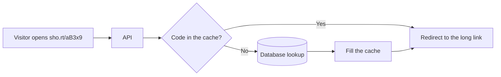
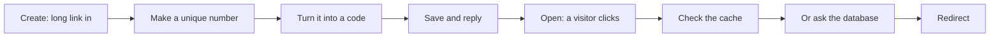
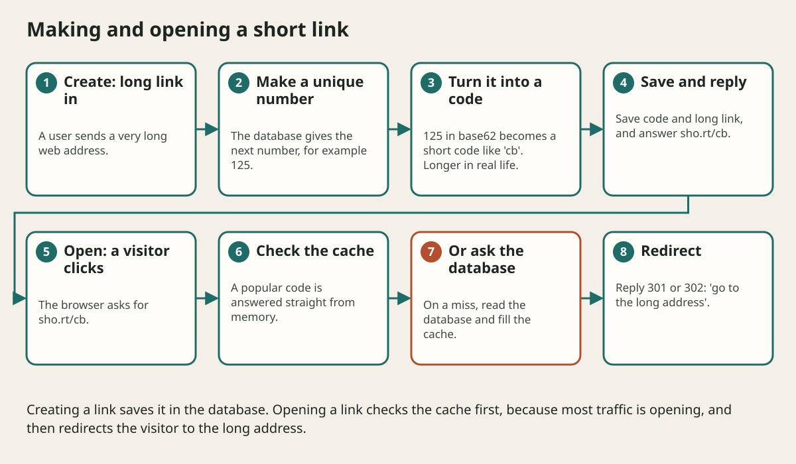

# Design A Url Shortener Step By Step

## The big idea in plain words {#picture}

You have a very long web address like https://example.com/articles/2026/10/how-to-build-a-treehouse-that-lasts?ref=newsletter. You want to share it in a text message. A short link like https://sho.rt/aB3x9 is much nicer, and it takes the visitor to the same place.

We will design this service from nothing, step by step, using the method from the course: ask, count, draw, find the weak spot, and explain.



## What you will be able to do {#outcomes}

By the end of this lesson you will be able to:

- Walk through all steps of a complete small design.
- Do the number estimates yourself.
- Explain which parts to keep simple and which to improve first.

## Words to know {#vocabulary}

- **short code**: the few letters and numbers at the end of the short link.
- **redirect**: a reply that says "go to this other address".
- **read-heavy**: far more reads than writes.
- **collision**: two links getting the same code.
- **base62**: writing a number using 62 symbols: 0-9, a-z, and A-Z.
- **expiry**: a date after which a link stops working.

## Why this idea exists {#history}

A short-link service is small enough to design in an hour but has real problems: lots of reads, unique codes, and caching. It is the "hello world" of system design.

## Concept 1: Step 1: What must it do? {#concept-1}

Two jobs: **create** a short link from a long one, and **open** a short link to go to the long one. Quality goals: opening should take under 100 milliseconds, and a link must never point to the wrong place. A non-goal for now: statistics dashboards.

## Concept 2: Step 2: Count {#concept-2}

Say 1 million new links per day. That is 1,000,000 divided by 86,400 seconds, about 12 creates per second. If each link is opened 10 times, that is 120 opens per second, with a busy hour maybe 3 times more, about 360 per second. A link record is about 500 bytes, so 1 million per day for 5 years is 1,825 million records, near 900 GB. One good database can handle it, but we will plan for growth.

## Concept 3: Step 3: Make the short code {#concept-3}

Give every link a unique number (1, 2, 3...). Write that number in base62: with 7 characters we get 62 to the power of 7, about 3.5 trillion codes, far more than we need. The database has a unique rule on the code, so if two codes ever clash, one request is told to try again.

## Concept 4: Step 4: Draw and speed it up {#concept-4}

API and database make the first drawing. Reads are most of the traffic, so we add a cache: popular codes are answered from memory. A cache miss reads the database and fills the cache. Opening replies with a redirect. Writing goes to the database only. If the cache fails, the service is slower but still correct.

## What if the database is down? {#example}

Opening a link that is in the cache still works. A link not in the cache gets "please try again soon". Creating a link says "try again" too. We never invent a link or say "link not found" when the real problem is the database being down.

## Going deeper: the technical walkthrough {#walkthrough}

## Worked scenario {#worked-scenario}

Opening a short link must be very fast, and most traffic is opens. What is the best first improvement?

The justified choice is **Cache popular codes in memory in front of the database**. Select **cache-hot-links** in the structured practical and explain why. Alternatives ignore a requirement, cross a trust boundary, or invent success.

### Structured decision contract

```json

{
  "decision": "cache-hot-links",
  "justification": "The shortCode and redirect boundary must preserve the declared contract and ownership.",
  "failureBehavior": "Expose a safe failure and recover through the boundary owner."
}

```

Decision selects one declared behavior. Justification explains the boundary. FailureBehavior explains the observable error and recovery owner. These fields never execute commands. Required terms and minimum lengths form a basic practice rubric, not semantic grading.

## Step-by-step flow and matching picture {#flow}





## Three real-life uses {#use-cases}

1. Social media posts use short links to save space.
2. Marketing emails use short links to count clicks.
3. QR codes point to short links so the printed code never has to change.

## What can go wrong, and how to stay safe {#failure-security}

Mistakes: guessable codes that let people walk through every link (add randomness for private links), allowing links to bad addresses, and forgetting rate limits so robots create millions of links. Also decide what happens to expired or deleted links: a clear "gone" answer is better than silence.

## Practice lab and expected observation {#practice}

1. Predict the scenario decision before opening Practical. Explain each rejected alternative.
2. Run a relevant example above in an isolated exercise project. Record the expected result, then change one input to an invalid or boundary value. A failed assertion or deliberate error should replace silent success.
3. Submit the structured decision. Initially the checks fail. After selecting cache-hot-links and writing an explanation and failure plan, all three pass. Follow the indicated review section for missed checks.

### Broken example to debug

```json

{"decision":"trust-client","justification":"","failureBehavior":""}

```

This ignores the responsible boundary and gives no reasoning or recovery. Correct the fields rather than changing the validator.

## Checkpoint and definition of done {#checkpoint}

- [ ] Define shortCode and redirect without looking.
- [ ] Trace input to owner and output.
- [ ] Explain one failure and one alternative.
- [ ] Pass at least four assignment questions.
- [ ] Pass every practical check and submit.
- [ ] Explain the concept again tomorrow.

## Sources, versions, and safe commands {#sources}

Workload figures are assumptions until measured. Review date: 2026-10-02. The supplied blueprint is the teaching source; official landing pages were checked where reachable. No provider or original TM Schedule deployment was tested.

- [Official reference](https://www.postgresql.org/docs/current/)

- [Official reference](https://opentelemetry.io/docs/)

[Course reading order](README.md) · [Previous lesson](18-application-architecture-cookbook-and-decision-guide.md) · [Next lesson](18b-design-a-chat-app-step-by-step.md)

```study-quiz

{
  "schemaVersion": 1,
  "lessonId": "system-design/18a-design-a-url-shortener-step-by-step",
  "title": "Assignment: Design A Url Shortener Step By Step",
  "passPercentage": 80,
  "questions": [
    {
      "id": "q1",
      "sectionId": "concept-1",
      "prompt": "In Design A Url Shortener Step By Step, what does shortCode mean?",
      "options": [
        {
          "id": "a",
          "text": "the few characters at the end of a short link",
          "explanation": "This preserves the definition and boundary described in the lesson."
        },
        {
          "id": "b",
          "text": "A permission granted by a hidden browser control",
          "explanation": "This changes the declared meaning or bypasses the responsible boundary."
        },
        {
          "id": "c",
          "text": "An unlimited provider operation with no ownership",
          "explanation": "This changes the declared meaning or bypasses the responsible boundary."
        },
        {
          "id": "d",
          "text": "A diagnostic credential intended for public logs",
          "explanation": "This changes the declared meaning or bypasses the responsible boundary."
        }
      ],
      "correctOptionId": "a",
      "explanation": "shortCode means the few characters at the end of a short link.",
      "reviewLabel": "Review concept 1"
    },
    {
      "id": "q2",
      "sectionId": "concept-2",
      "prompt": "In Design A Url Shortener Step By Step, which rule is correct for checkpoint 2?",
      "options": [
        {
          "id": "a",
          "text": "Trust client-side checks instead of the server rule.",
          "explanation": "This changes the declared meaning or bypasses the responsible boundary."
        },
        {
          "id": "b",
          "text": "The short code can be made from a unique id turned into letters and numbers.",
          "explanation": "This preserves the definition and boundary described in the lesson."
        },
        {
          "id": "c",
          "text": "Hide the failure by returning a fabricated successful result.",
          "explanation": "This changes the declared meaning or bypasses the responsible boundary."
        },
        {
          "id": "d",
          "text": "Skip the stated boundary, limit, or ownership check.",
          "explanation": "This changes the declared meaning or bypasses the responsible boundary."
        }
      ],
      "correctOptionId": "b",
      "explanation": "The short code can be made from a unique id turned into letters and numbers.",
      "reviewLabel": "Review concept 2"
    },
    {
      "id": "q3",
      "sectionId": "concept-3",
      "prompt": "In Design A Url Shortener Step By Step, which rule is correct for checkpoint 3?",
      "options": [
        {
          "id": "a",
          "text": "Trust client-side checks instead of the server rule.",
          "explanation": "This changes the declared meaning or bypasses the responsible boundary."
        },
        {
          "id": "b",
          "text": "Hide the failure by returning a fabricated successful result.",
          "explanation": "This changes the declared meaning or bypasses the responsible boundary."
        },
        {
          "id": "c",
          "text": "The server answers an open request with a redirect, status 301 or 302, pointing to the long address.",
          "explanation": "This preserves the definition and boundary described in the lesson."
        },
        {
          "id": "d",
          "text": "Skip the stated boundary, limit, or ownership check.",
          "explanation": "This changes the declared meaning or bypasses the responsible boundary."
        }
      ],
      "correctOptionId": "c",
      "explanation": "The server answers an open request with a redirect, status 301 or 302, pointing to the long address.",
      "reviewLabel": "Review concept 3"
    },
    {
      "id": "q4",
      "sectionId": "concept-4",
      "prompt": "In Design A Url Shortener Step By Step, which rule is correct for checkpoint 4?",
      "options": [
        {
          "id": "a",
          "text": "Trust client-side checks instead of the server rule.",
          "explanation": "This changes the declared meaning or bypasses the responsible boundary."
        },
        {
          "id": "b",
          "text": "Hide the failure by returning a fabricated successful result.",
          "explanation": "This changes the declared meaning or bypasses the responsible boundary."
        },
        {
          "id": "c",
          "text": "Skip the stated boundary, limit, or ownership check.",
          "explanation": "This changes the declared meaning or bypasses the responsible boundary."
        },
        {
          "id": "d",
          "text": "A cache holds popular links so most opens never reach the database.",
          "explanation": "This preserves the definition and boundary described in the lesson."
        }
      ],
      "correctOptionId": "d",
      "explanation": "A cache holds popular links so most opens never reach the database.",
      "reviewLabel": "Review concept 4"
    },
    {
      "id": "q5",
      "sectionId": "worked-scenario",
      "prompt": "Opening a short link must be very fast, and most traffic is opens. What is the best first improvement?",
      "options": [
        {
          "id": "a",
          "text": "Cache popular codes in memory in front of the database",
          "explanation": "This preserves the definition and boundary described in the lesson."
        },
        {
          "id": "b",
          "text": "Shard the database right away",
          "explanation": "This changes the declared meaning or bypasses the responsible boundary."
        },
        {
          "id": "c",
          "text": "Generate a new code for every open",
          "explanation": "This changes the declared meaning or bypasses the responsible boundary."
        },
        {
          "id": "d",
          "text": "Store codes in the browser only",
          "explanation": "This changes the declared meaning or bypasses the responsible boundary."
        }
      ],
      "correctOptionId": "a",
      "explanation": "Cache popular codes in memory in front of the database. A collision check or a unique database rule makes sure two links never share a code.",
      "reviewLabel": "Review the worked scenario"
    }
  ]
}

```

```study-practical

{
  "schemaVersion": 1,
  "challengeId": "system-design/18a-design-a-url-shortener-step-by-step/decision",
  "lessonId": "system-design/18a-design-a-url-shortener-step-by-step",
  "title": "Practical: Design A Url Shortener Step By Step",
  "language": "json",
  "mode": "structured",
  "instructions": "Opening a short link must be very fast, and most traffic is opens. What is the best first improvement? Return an object with decision (choose from cache-hot-links, skip-check, unbounded-work, trust-client), justification (at least 40 characters; include shortCode and redirect), and failureBehavior (at least 25 characters; include failure and recover while explaining the error and recovery). These are structured reasoning checks, not code execution or an official grade.",
  "starterCode": "{\n  \"decision\": \"\",\n  \"justification\": \"\",\n  \"failureBehavior\": \"\"\n}",
  "entryPoint": "answer",
  "publicExamples": [
    {
      "input": {
        "decision": "skip-check",
        "justification": "",
        "failureBehavior": ""
      },
      "expected": {
        "passed": false
      }
    },
    {
      "input": {
        "decision": "cache-hot-links",
        "justification": "The shortCode and redirect boundary must preserve the declared contract and ownership.",
        "failureBehavior": "Show a safe failure and recover through the responsible owner."
      },
      "expected": {
        "passed": true
      }
    }
  ],
  "publicTestIds": [
    "decision",
    "explanation",
    "failure-plan"
  ],
  "reviewSections": {
    "decision": "worked-scenario",
    "explanation": "concept-2",
    "failure-plan": "failure-security"
  },
  "limits": {
    "timeMs": 2000,
    "memoryMb": 128,
    "outputBytes": 20000
  }
}

```

