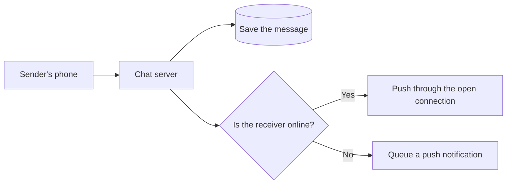
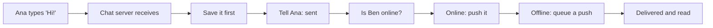
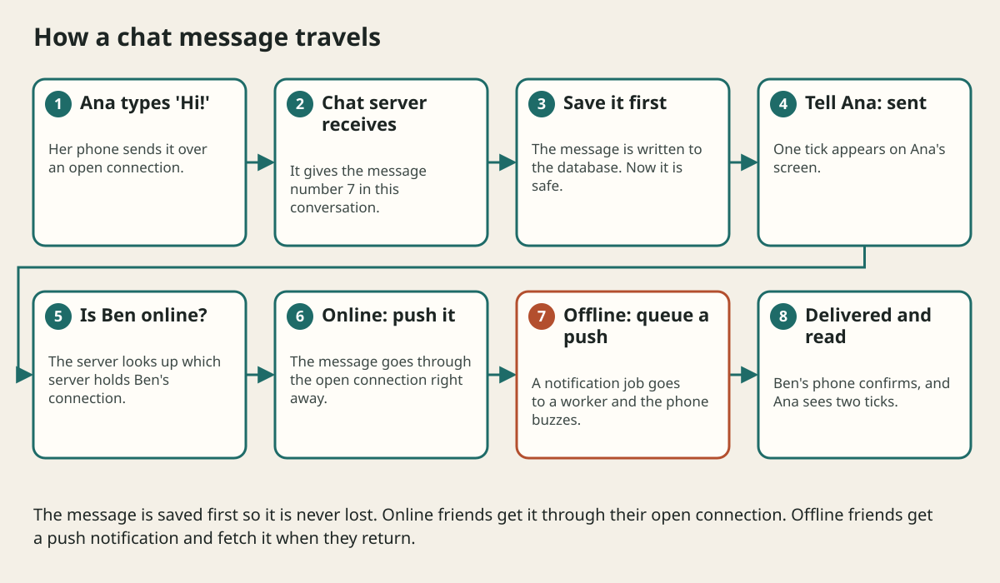

# Design A Chat App Step By Step

## The big idea in plain words {#picture}

When you send a message to a friend, it feels like magic: it appears on their screen in a blink. Under the hood, a lot of careful work makes sure the message is saved, arrives, arrives only once, and stays in the right order.

We will design a small chat app using the course method. The key new idea is a **live connection**: instead of the phone asking "any news?" every second, the connection stays open and the server can call out the moment a new message arrives.



## What you will be able to do {#outcomes}

By the end of this lesson you will be able to:

- Explain live connections, saving first, and delivery to offline friends.
- Explain why ordering is per conversation.
- Describe how to grow the chat by splitting on conversation.

## Words to know {#vocabulary}

- **websocket**: a connection that stays open so the server can send you messages at any time.
- **fanout**: sending one message to many receivers, as in a group.
- **ordering**: messages appear in the order they were sent.
- **delivered / read**: two different statuses: arrived on the phone, and seen by the person.
- **push notification**: an alert sent to a phone when the app is closed.
- **presence**: showing whether someone is online.

## Why this idea exists {#history}

People expect chat to be instant, never lose messages, and keep order. Those three promises touch connections, storage, and queues, so chat is a great way to review everything you learned.

## Concept 1: Open connections for instant messages {#concept-1}

Normal web requests are like sending letters: you ask, they answer. A websocket is like a phone call that stays on. The server can speak first. Each chat server keeps thousands of such calls open, so we run many servers, and we need a shared place to know who is connected to which server.

## Concept 2: Save first, send second {#concept-2}

When a message arrives, we write it to the database before telling anyone. If the receiver is offline or the server crashes, the message is safe. When the receiver comes back, their phone asks: "give me everything after message 1042."

## Concept 3: Keep order inside one conversation {#concept-3}

Nobody needs messages from all over the world in one global order. We only need each chat to be in order. So each message gets a number within its conversation (1, 2, 3...). We can also split data by conversation id, so one chat's messages live together, which makes reading a chat's history quick.

## Concept 4: Groups and notifications use a queue {#concept-4}

A message to a group of 500 people is 500 deliveries. We put those jobs in a queue and let workers do them. Offline members get a push notification through the same queue. If a delivery fails, it is retried a few times and not lost. Delivery steps like "sent", "delivered", "read" are saved as small status updates.

## Sending "Hi!" {#example}

Ana sends "Hi!" to Ben. The chat server gives it number 7 in their conversation, saves it, and replies "sent" to Ana. Ben is online, so the server pushes it through his open connection. His phone shows it and replies "delivered". When Ben opens the chat, the app sends "read" back, and Ana sees two ticks.

## Going deeper: the technical walkthrough {#walkthrough}

## Worked scenario {#worked-scenario}

A friend is offline when you send a message. What should the chat system do?

The justified choice is **Save the message and deliver it, plus a push notification, when they come back**. Select **store-and-deliver** in the structured practical and explain why. Alternatives ignore a requirement, cross a trust boundary, or invent success.

### Structured decision contract

```json

{
  "decision": "store-and-deliver",
  "justification": "The websocket and fanout boundary must preserve the declared contract and ownership.",
  "failureBehavior": "Expose a safe failure and recover through the boundary owner."
}

```

Decision selects one declared behavior. Justification explains the boundary. FailureBehavior explains the observable error and recovery owner. These fields never execute commands. Required terms and minimum lengths form a basic practice rubric, not semantic grading.

## Step-by-step flow and matching picture {#flow}





## Three real-life uses {#use-cases}

1. A school group chat for a class project.
2. A customer-support chat on a shop's website.
3. In-game chat that must work for thousands of players at once.

## What can go wrong, and how to stay safe {#failure-security}

Mistakes: sending without saving, showing messages in different orders to different people, forgetting that a receiver may be offline, and storing messages forever with no rules. Also, chat messages are private, so every read must check that the person belongs to the conversation.

## Practice lab and expected observation {#practice}

1. Predict the scenario decision before opening Practical. Explain each rejected alternative.
2. Run a relevant example above in an isolated exercise project. Record the expected result, then change one input to an invalid or boundary value. A failed assertion or deliberate error should replace silent success.
3. Submit the structured decision. Initially the checks fail. After selecting store-and-deliver and writing an explanation and failure plan, all three pass. Follow the indicated review section for missed checks.

### Broken example to debug

```json

{"decision":"trust-client","justification":"","failureBehavior":""}

```

This ignores the responsible boundary and gives no reasoning or recovery. Correct the fields rather than changing the validator.

## Checkpoint and definition of done {#checkpoint}

- [ ] Define websocket and fanout without looking.
- [ ] Trace input to owner and output.
- [ ] Explain one failure and one alternative.
- [ ] Pass at least four assignment questions.
- [ ] Pass every practical check and submit.
- [ ] Explain the concept again tomorrow.

## Sources, versions, and safe commands {#sources}

Workload figures are assumptions until measured. Review date: 2026-10-02. The supplied blueprint is the teaching source; official landing pages were checked where reachable. No provider or original TM Schedule deployment was tested.

- [Official reference](https://www.postgresql.org/docs/current/)

- [Official reference](https://opentelemetry.io/docs/)

[Course reading order](README.md) · [Previous lesson](18a-design-a-url-shortener-step-by-step.md) · [Next lesson](19-glossary-checklists-and-practice-answers.md)

```study-quiz

{
  "schemaVersion": 1,
  "lessonId": "system-design/18b-design-a-chat-app-step-by-step",
  "title": "Assignment: Design A Chat App Step By Step",
  "passPercentage": 80,
  "questions": [
    {
      "id": "q1",
      "sectionId": "concept-1",
      "prompt": "In Design A Chat App Step By Step, what does websocket mean?",
      "options": [
        {
          "id": "a",
          "text": "A permission granted by a hidden browser control",
          "explanation": "This changes the declared meaning or bypasses the responsible boundary."
        },
        {
          "id": "b",
          "text": "a connection that stays open so the server can push messages to you at any time",
          "explanation": "This preserves the definition and boundary described in the lesson."
        },
        {
          "id": "c",
          "text": "An unlimited provider operation with no ownership",
          "explanation": "This changes the declared meaning or bypasses the responsible boundary."
        },
        {
          "id": "d",
          "text": "A diagnostic credential intended for public logs",
          "explanation": "This changes the declared meaning or bypasses the responsible boundary."
        }
      ],
      "correctOptionId": "b",
      "explanation": "websocket means a connection that stays open so the server can push messages to you at any time.",
      "reviewLabel": "Review concept 1"
    },
    {
      "id": "q2",
      "sectionId": "concept-2",
      "prompt": "In Design A Chat App Step By Step, which rule is correct for checkpoint 2?",
      "options": [
        {
          "id": "a",
          "text": "Trust client-side checks instead of the server rule.",
          "explanation": "This changes the declared meaning or bypasses the responsible boundary."
        },
        {
          "id": "b",
          "text": "Hide the failure by returning a fabricated successful result.",
          "explanation": "This changes the declared meaning or bypasses the responsible boundary."
        },
        {
          "id": "c",
          "text": "Messages are saved first, so they are never lost if a receiver is offline.",
          "explanation": "This preserves the definition and boundary described in the lesson."
        },
        {
          "id": "d",
          "text": "Skip the stated boundary, limit, or ownership check.",
          "explanation": "This changes the declared meaning or bypasses the responsible boundary."
        }
      ],
      "correctOptionId": "c",
      "explanation": "Messages are saved first, so they are never lost if a receiver is offline.",
      "reviewLabel": "Review concept 2"
    },
    {
      "id": "q3",
      "sectionId": "concept-3",
      "prompt": "In Design A Chat App Step By Step, which rule is correct for checkpoint 3?",
      "options": [
        {
          "id": "a",
          "text": "Trust client-side checks instead of the server rule.",
          "explanation": "This changes the declared meaning or bypasses the responsible boundary."
        },
        {
          "id": "b",
          "text": "Hide the failure by returning a fabricated successful result.",
          "explanation": "This changes the declared meaning or bypasses the responsible boundary."
        },
        {
          "id": "c",
          "text": "Skip the stated boundary, limit, or ownership check.",
          "explanation": "This changes the declared meaning or bypasses the responsible boundary."
        },
        {
          "id": "d",
          "text": "Messages are ordered inside one conversation, not across the whole world.",
          "explanation": "This preserves the definition and boundary described in the lesson."
        }
      ],
      "correctOptionId": "d",
      "explanation": "Messages are ordered inside one conversation, not across the whole world.",
      "reviewLabel": "Review concept 3"
    },
    {
      "id": "q4",
      "sectionId": "concept-4",
      "prompt": "In Design A Chat App Step By Step, which rule is correct for checkpoint 4?",
      "options": [
        {
          "id": "a",
          "text": "A queue helps with fanout when a message goes to many people in a group.",
          "explanation": "This preserves the definition and boundary described in the lesson."
        },
        {
          "id": "b",
          "text": "Trust client-side checks instead of the server rule.",
          "explanation": "This changes the declared meaning or bypasses the responsible boundary."
        },
        {
          "id": "c",
          "text": "Hide the failure by returning a fabricated successful result.",
          "explanation": "This changes the declared meaning or bypasses the responsible boundary."
        },
        {
          "id": "d",
          "text": "Skip the stated boundary, limit, or ownership check.",
          "explanation": "This changes the declared meaning or bypasses the responsible boundary."
        }
      ],
      "correctOptionId": "a",
      "explanation": "A queue helps with fanout when a message goes to many people in a group.",
      "reviewLabel": "Review concept 4"
    },
    {
      "id": "q5",
      "sectionId": "worked-scenario",
      "prompt": "A friend is offline when you send a message. What should the chat system do?",
      "options": [
        {
          "id": "a",
          "text": "Throw the message away",
          "explanation": "This changes the declared meaning or bypasses the responsible boundary."
        },
        {
          "id": "b",
          "text": "Save the message and deliver it, plus a push notification, when they come back",
          "explanation": "This preserves the definition and boundary described in the lesson."
        },
        {
          "id": "c",
          "text": "Keep the sender waiting until the friend returns",
          "explanation": "This changes the declared meaning or bypasses the responsible boundary."
        },
        {
          "id": "d",
          "text": "Send it to a random person",
          "explanation": "This changes the declared meaning or bypasses the responsible boundary."
        }
      ],
      "correctOptionId": "b",
      "explanation": "Save the message and deliver it, plus a push notification, when they come back. Sharding by conversation id keeps all messages of one chat together on one shard.",
      "reviewLabel": "Review the worked scenario"
    }
  ]
}

```

```study-practical

{
  "schemaVersion": 1,
  "challengeId": "system-design/18b-design-a-chat-app-step-by-step/decision",
  "lessonId": "system-design/18b-design-a-chat-app-step-by-step",
  "title": "Practical: Design A Chat App Step By Step",
  "language": "json",
  "mode": "structured",
  "instructions": "A friend is offline when you send a message. What should the chat system do? Return an object with decision (choose from store-and-deliver, skip-check, unbounded-work, trust-client), justification (at least 40 characters; include websocket and fanout), and failureBehavior (at least 25 characters; include failure and recover while explaining the error and recovery). These are structured reasoning checks, not code execution or an official grade.",
  "starterCode": "{\n  \"decision\": \"\",\n  \"justification\": \"\",\n  \"failureBehavior\": \"\"\n}",
  "entryPoint": "answer",
  "publicExamples": [
    {
      "input": {
        "decision": "skip-check",
        "justification": "",
        "failureBehavior": ""
      },
      "expected": {
        "passed": false
      }
    },
    {
      "input": {
        "decision": "store-and-deliver",
        "justification": "The websocket and fanout boundary must preserve the declared contract and ownership.",
        "failureBehavior": "Show a safe failure and recover through the responsible owner."
      },
      "expected": {
        "passed": true
      }
    }
  ],
  "publicTestIds": [
    "decision",
    "explanation",
    "failure-plan"
  ],
  "reviewSections": {
    "decision": "worked-scenario",
    "explanation": "concept-2",
    "failure-plan": "failure-security"
  },
  "limits": {
    "timeMs": 2000,
    "memoryMb": 128,
    "outputBytes": 20000
  }
}

```

